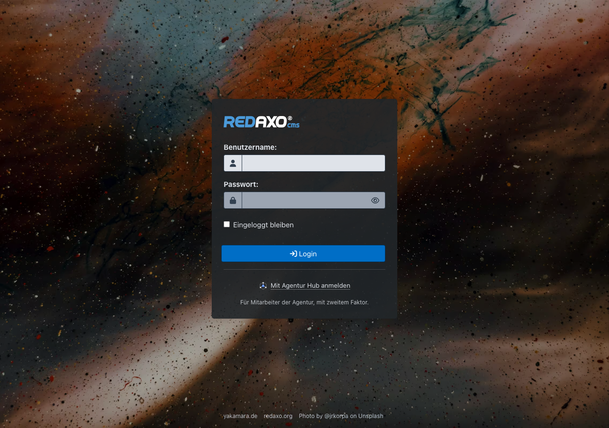
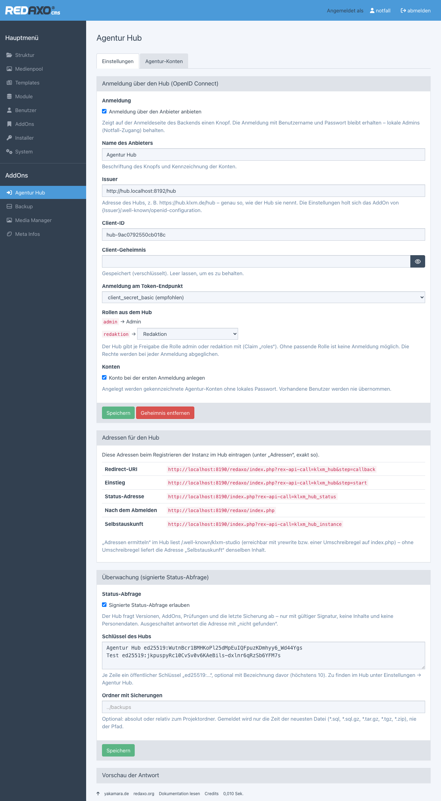

# Agentur Hub für REDAXO 5 (`klxm_hub`)

Mit diesem AddOn nimmt eine REDAXO-5-Website am **Agentur Hub** teil (Erweiterung `agentur` von KLXM Studio):

- **Anmeldung über den Hub** – Mitarbeiter der Agentur melden sich im Backend per OpenID Connect an (Einmal-Anmeldung,
  zweiter Faktor ist Pflicht). Auf der Anmeldeseite erscheint unter dem Formular der Link „Mit Agentur Hub anmelden“
  mit dem Logo des Anbieters; „Öffnen“ im Hub meldet direkt an.
- **Überwachung** – eine signierte, lesende Status-Abfrage (Protokoll `status-v1`): Versionen von REDAXO und PHP,
  AddOns und PlugIns, Ampel der Prüfungen, letzte Sicherung, Fehlerprotokoll (nur Zahlen). Keine Inhalte, keine
  Personendaten.
- **Selbstauskunft** (`klxm-instance-v1`) – „Adressen ermitteln“ im Hub liest die Adressen dieser Installation selbst.

Alles ist **standardmäßig aus** und ändert nichts an der Darstellung der Website. English: [README.md](README.md)

Gegenstück für REDAXO 6: [KLXM-Studio/redaxo-klxm-hub](https://github.com/KLXM-Studio/redaxo-klxm-hub) – gleicher
Aufbau und gleiche Klassen (`Klxm\Hub\…`), damit Korrekturen in beide Fassungen wandern.

| Anmeldeseite | Einstellungen |
|---|---|
|  |  |

## Voraussetzungen

- **REDAXO ab 5.17** (getestet mit 5.17.1 und 5.21.6) mit dem AddOn `users`
  – 5.15 brachte Passkeys und die Sitzungstabelle `rex_user_session`, 5.17 `rex_api_function::register()` für
  API-Funktionen mit Namensraum.
- **PHP ab 8.3** mit `sodium` (Ed25519, Verschlüsselung), `openssl` (RS256), `dom`, `mbstring`.

## Installation

Das AddOn steht (noch) nicht im Installer. Ordner als `redaxo/src/addons/klxm_hub` ablegen, dann
AddOns → Agentur Hub → installieren und aktivieren (oder `php redaxo/bin/console package:install klxm_hub`).

## Einrichtung

1. **In REDAXO:** System → Einstellungen → **URL der Website** prüfen (z. B. `https://www.example.org/`). Daraus
   entstehen Redirect-URI und Status-Adresse; fehlt sie, warnt das AddOn (sonst hingen die Adressen am Host der Anfrage).
2. **In REDAXO:** AddOns → Agentur Hub → Einstellungen → Überwachung: öffentlichen Schlüssel des Hubs (`ed25519:…`,
   im Hub unter Einstellungen → Agentur Hub) eintragen, „Signierte Status-Abfrage erlauben“ → Speichern. Für die
   Anmeldung den Issuer eintragen (z. B. `https://hub.klxm.de/hub`) und speichern – noch ohne Einschalten.
3. **Im Hub:** Verwalten → Instanz registrieren → Adresse der Website → **„Adressen ermitteln“** (liest die
   Selbstauskunft) → „Adressen übernehmen“ → registrieren. Ohne Selbstauskunft die Adressen von Hand eintragen
   (System „REDAXO 6“ wählen – die Adressen sind dieselben):

   | | Adresse |
   |---|---|
   | Redirect-URI | `https://<host>/redaxo/index.php?rex-api-call=klxm_hub&step=callback` |
   | Einstieg | `https://<host>/redaxo/index.php?rex-api-call=klxm_hub&step=start` |
   | Status | `https://<host>/index.php?rex-api-call=klxm_hub_status` |
   | Nach dem Abmelden | `https://<host>/redaxo/index.php` |

   Client-ID und Client-Geheimnis erscheinen **einmal**. Freigaben je Person mit Rolle `admin` oder `redaktion`.
4. **In REDAXO:** Client-ID, Client-Geheimnis, Rolle für `redaktion`, „Anmeldung über den Anbieter anbieten“ →
   Speichern. Das AddOn prüft dabei, ob der Hub erreichbar ist (Discovery), sonst bleibt die Anmeldung aus.
5. **Im Hub:** „Jetzt prüfen“ – die Ampel erscheint.
6. **Notfall-Admin behalten:** mindestens einen lokalen Admin mit Passwort (und Passkey). Das AddOn warnt, wenn keiner
   da ist.

Der Kasten „Adressen für den Hub“ in den Einstellungen zeigt alle Adressen dieser Installation.

### Selbstauskunft (`klxm-instance-v1`)

`GET /.well-known/klxm-studio` – Name der Website, Redirect-URI, Einstieg, Adresse nach dem Abmelden, Status-Adresse;
`404`, solange weder Anmeldung noch Überwachung eingerichtet sind. Keine Versionen, keine Schlüssel, keine Personendaten.
Die Adresse funktioniert, wenn die Anfrage `index.php` erreicht (yrewrite bzw. eine Umschreibregel). Ohne Umschreibregel
liefert `GET /index.php?rex-api-call=klxm_hub_instance` denselben Inhalt; für den Hub reicht eine Regel wie

```apache
RewriteRule ^\.well-known/klxm-studio$ index.php?rex-api-call=klxm_hub_instance [L,QSA]
```

## Agentur-Konten

- Zuordnung über Issuer + `sub` des Hubs (Tabelle `rex_klxm_hub_identity`), nie über die E-Mail-Adresse.
- Bei der ersten Anmeldung wird ein Konto angelegt (abschaltbar): Login = E-Mail-Adresse (bzw. `hub-…`), **ohne
  Passwort**, Beschreibung „Agentur-Konto (Agentur Hub) – Anmeldung nur über den Anbieter“. Meldet der Hub die Adresse
  als unbestätigt (`email_verified` ≠ true), wird sie weder Login noch E-Mail des Kontos.
- Rolle aus dem Claim `roles`: `admin` → Admin, `redaktion` → die eingestellte Rolle; ohne passende Rolle keine
  Anmeldung. Die Rechte werden bei **jeder** Anmeldung abgeglichen.
- Vorhandene Benutzer werden **nie übernommen** (gleicher Login → Anmeldung abgelehnt). Bekommt ein Agentur-Konto
  lokal ein Passwort, lehnt der Hub-Zugang es ab – es ist dann ein lokales Konto.
- **Nur über den Hub:** Eine Sitzung eines Agentur-Kontos (ohne Passwort), die per Passkey entstanden ist, beendet das
  AddOn sofort – sonst wirkte ein Entzug im Hub nicht, solange das Konto lokal einen Passkey hat.
- **Sperren:** AddOns → Agentur Hub → Agentur-Konten → „Sperren“ (oder Status in der Benutzerverwaltung). Laufende
  Sitzungen enden sofort. Löschen über die Benutzerverwaltung – die Zuordnung verschwindet mit.

## Sicherheit

- Authorization Code Flow mit **PKCE S256**, `state` (32 Byte, an die Backend-Sitzung gebunden, einmal verwendbar,
  10 Minuten), `nonce`; Rückkehr mit `iss` nach RFC 9207 (Pflicht, wenn der Hub ihn ankündigt).
- ID-Token nur **RS256**, Schlüssel aus dem JWKS des Hubs (unbekannte `kid` → einmal neu laden, höchstens alle
  60 Sekunden); geprüft werden `iss`, `aud`/`azp`, `exp`/`iat` (±60 s, nicht älter als 10 Minuten), `nonce`,
  `at_hash`, `sub`. `none`, HS* und `crit` werden abgewiesen, RSA-Schlüssel unter 2048 Bit (bitgenau) und mit
  Exponent < 3 bzw. gerade ebenso; `jku`, `x5u` und `jwk` im Kopf werden nie verwendet.
- **Zweiter Faktor:** `amr` muss einen zweiten Faktor belegen (`mfa`, `otp`, `hwk`, …) – Passwort allein reicht nicht.
- Abrufe beim Hub über `rex_socket`: nur https, ohne Weiterleitungen, höchstens 10 Sekunden je Lesevorgang,
  15 Sekunden und 512 KB insgesamt.
- **Keine Abrufe ins interne Netz (SSRF):** Discovery, JWKS, Token und Logo gehen nie an private, lokale oder
  reservierte Adressen (127/8, 10/8, 172.16/12, 192.168/16, 169.254/16, 100.64/10, ::1, fc00::/7, fe80::/10, IPv4 in
  IPv6, NAT64, 6to4 …). Geprüft werden alle aufgelösten Adressen, verbunden wird genau mit der geprüften (TLS-Prüfung
  weiter gegen den Hostnamen; kein DNS-Rebinding). Mit einem ausgehenden Proxy (`socket_proxy`) wird ebenso geprüft,
  die Verbindung baut der Proxy auf.
- **Logo** des Anbieters (`logo_uri`): nur beim Speichern geladen, als SVG neu aufgebaut (nur Formen, keine Texte,
  Skripte, Stile, Verweise, Ereignisse, fremden Namensräume; nur UTF-8, keine DTD), lokal abgelegt und bei jeder Ausgabe
  erneut bereinigt – die Anmeldeseite lädt nie etwas vom Anbieter.
- Antworten des Anmelde-Endpunkts mit `Cache-Control: no-store`; der Link auf der Anmeldeseite ist relativ.
- Client-Geheimnis verschlüsselt (libsodium secretbox); der Schlüssel liegt in `redaxo/data/addons/klxm_hub/secret.key`,
  nicht in der Datenbank. Alternativ ohne Speicherung: Umgebungsvariable `KLXM_HUB_CLIENT_SECRET`.
- **Rate-Limit** je IP: Anmeldung 30 Aufrufe bzw. 10 Fehlversuche in 10 Minuten, Status-Abfrage 30 in 10 Minuten.
  IP-Adressen nur als HMAC gespeichert.
- **Protokoll** im Systemprotokoll von REDAXO, eine Zeile je Ereignis ohne Geheimnisse, z. B.
  `klxm_hub: login-denied reason=state ip=…`, `klxm_hub: login-ok user=12 created=1`,
  `klxm_hub: monitor-denied reason=signature`. Hinter einem Proxy die vertrauenswürdigen Proxys in Symfony
  (`Request::setTrustedProxies`) setzen, sonst steht dort die IP des Proxys.

### Umgebungsvariablen

REDAXO 5 kennt kein `.env` – gesetzt z. B. per `SetEnv` (Apache), `env[…]` im PHP-FPM-Pool:

| Variable | Wirkung |
|---|---|
| `KLXM_HUB_CLIENT_SECRET` | Client-Geheimnis (steht dann nicht in der Datenbank) |
| `KLXM_HUB_ALLOW_PRIVATE_NETWORK=1` | Hub im eigenen Netz bzw. Proxy mit privater Adresse: Abrufe an private Adressen erlaubt |
| `KLXM_HUB_ALLOW_HTTP=1` | Hub ohne https – **nur für Tests** im lokalen Netz |

### Status-Abfrage (`status-v1`)

Prüfung in dieser Reihenfolge: aus oder kein Schlüssel → `404`; Rate-Limit → `429`; Format der Kopfzeilen, Zeitfenster
±300 s, Schlüssel-ID, Ed25519-Signatur (Host aus der Anfrage, Pfad mit Query aus `REQUEST_URI`) → `401`; erst nach
gültiger Signatur wird der Nonce gemerkt – 11 Minuten, also länger als das ganze Zeitfenster (Wiederholung → `401`);
dann `200` mit JSON (`system: "redaxo5"`, 60 Sekunden zwischengespeichert, `Cache-Control: no-store`,
`X-Robots-Tag: noindex`). Fehlerantworten nennen keine Gründe.

Prüfungen der Ampel (Kategorie `technical`): Datenbank, beschreibbare Ordner, offenes Setup, Debug-Modus auf
öffentlicher Adresse, abgesicherter Modus, HTTPS, AddOns als Entwicklungsfassung, OPcache, Notfall-Admin. Das
Fehlerprotokoll (24 Stunden) geht als Feld `log` mit; der Hub bewertet es selbst. `integrity` meldet `unknown`.

## Für Entwickler

Erweiterungspunkte:

```php
// Status ergänzen: eigene Prüfungen, Sicherung eines Backup-Werkzeugs
rex_extension::register('KLXM_HUB_STATUS', static function (rex_extension_point $ep): array {
    $status = $ep->getSubject();
    $status['backup']['offsite_at'] = date('c', MyBackup::lastUpload());
    if ($ep instanceof Klxm\Hub\ExtensionPoint\HubStatus && MyQueue::stuck()) {
        $ep->warning('Warteschlange hängt');                 // zählt in der Ampel
        $ep->warning('3 Bilder ohne Alt-Text', 'editorial');  // nur Hinweis im Hub (setup/editorial)
    }
    return $status;
});

// Rechte eines Agentur-Kontos anpassen (null = Anmeldung ablehnen)
rex_extension::register('KLXM_HUB_USER_MAPPING', static function (rex_extension_point $ep): ?array {
    if (in_array('technik', $ep->getParam('hub_roles'), true)) {
        return ['admin' => false, 'roles' => [3]];
    }
    return $ep->getSubject();
});
```

Konsole:

- `php redaxo/bin/console klxm_hub:selftest` – Prüfungen ohne Netz und Datenbank (Signatur, PKCE, ID-Token, Schlüsselwechsel,
  Verschlüsselung, Logo-Bereinigung, Abrufschutz, Selbstauskunft).
- `php redaxo/bin/console klxm_hub:logo` – Logo des Anbieters neu laden.

### Was der Core nicht bietet

- **Anmelden eines Benutzers per Code:** Das AddOn setzt die Sitzung wie die Passkey-Anmeldung des Cores
  (`rex_backend_login::checkLogin`) und trägt sie in `rex_user_session` ein.
- **Link auf der Anmeldeseite:** kein Erweiterungspunkt in `pages/login.php`; der Link kommt über `OUTPUT_FILTER` in den
  Fuß des Formulars `#rex-form-login` (fehlt es, bleibt die Seite unverändert).
- **Abmelden beim Hub (RP-initiated Logout):** noch nicht umgesetzt.

## Unterschiede zur Fassung für REDAXO 6

| | REDAXO 5 | REDAXO 6 |
|---|---|---|
| Adresse der Website | System → URL der Website | `REX_BASE_URL` |
| http/private Netze für Tests | nur per Umgebungsvariable | Modus `dev` oder Umgebungsvariable |
| HTTP | `rex_socket` mit fester Zieladresse | HTTP-Client des Cores (Symfony) |
| Erweiterungspunkte | `KLXM_HUB_STATUS`, `KLXM_HUB_USER_MAPPING` | Klassennamen `HubStatus`, `HubUserMapping` |
| Status | `system: "redaxo5"`, PlugIns, Setup/Debug/Safe-Mode; keine Migrationen | `system: "redaxo6"`, Migrationen |
| Selbstauskunft `klxm-instance-v1` | ja | vorgemerkt |
| Passkey-Sitzungen von Agentur-Konten | beendet | – |
| Deinstallation | löscht die Tabellen | `migrate:cleanup` |

## Lizenz

MIT – siehe [LICENSE](LICENSE). KLXM Crossmedia GmbH.
