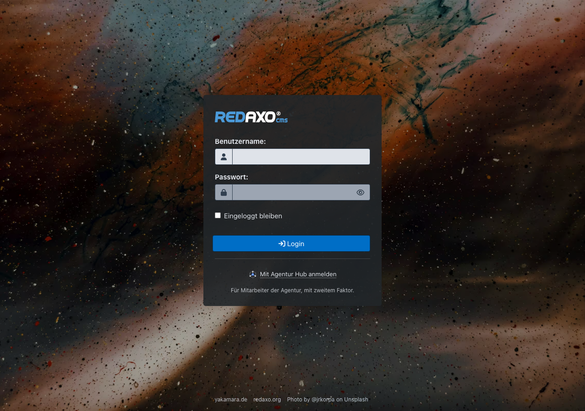
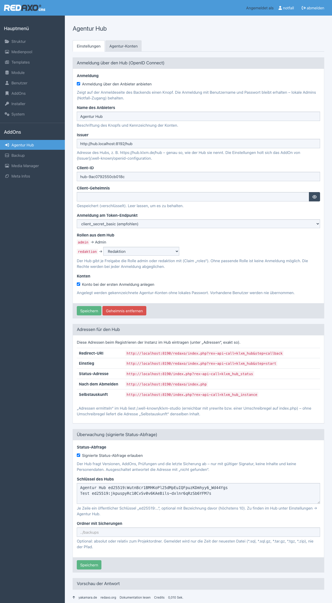

# Agentur Hub for REDAXO 5 (`klxm_hub`)

With this addon a REDAXO 5 website takes part in the **Agentur Hub** (extension `agentur` of KLXM Studio):

- **Sign-in via the hub** – agency staff sign in to the backend via OpenID Connect (single sign-on, a second factor is
  required). Below the login form the link “Sign in with Agentur Hub” appears with the provider's logo; “Open” in the
  hub signs in directly.
- **Monitoring** – a signed, read-only status request (protocol `status-v1`): versions of REDAXO and PHP, addons and
  plugins, check results, latest backup, error log (counts only). No content, no personal data.
- **Self-description** (`klxm-instance-v1`) – “Detect addresses” in the hub reads the addresses of this installation.

Everything is **off by default** and does not change how the website looks. Deutsch: [README.de.md](README.de.md)

Counterpart for REDAXO 6: [KLXM-Studio/redaxo-klxm-hub](https://github.com/KLXM-Studio/redaxo-klxm-hub) – same
structure and classes (`Klxm\Hub\…`), so fixes can move between both versions.

| Login page | Settings |
|---|---|
|  |  |

## Requirements

- **REDAXO 5.17 or later** (tested with 5.17.1 and 5.21.6) with the `users` addon – 5.15 introduced passkeys and the
  session table `rex_user_session`, 5.17 `rex_api_function::register()` for namespaced API functions.
- **PHP 8.3 or later** with `sodium` (Ed25519, encryption), `openssl` (RS256), `dom`, `mbstring`.

## Installation

The addon is not (yet) available in the installer. Put the folder at `redaxo/src/addons/klxm_hub`, then install and
activate it under AddOns (or `php redaxo/bin/console package:install klxm_hub`).

## Setup

1. **In REDAXO:** check System → Settings → **website URL** (e.g. `https://www.example.org/`). Redirect URI and status
   address are derived from it; if it is missing the addon warns (the addresses would depend on the request host).
2. **In REDAXO:** AddOns → Agentur Hub → Settings → Monitoring: enter the hub's public key (`ed25519:…`, in the hub
   under Settings → Agentur Hub), “Allow signed status requests” → Save. For sign-in enter the issuer (e.g.
   `https://hub.klxm.de/hub`) and save – without switching it on yet.
3. **In the hub:** Manage → Register instance → website address → **“Detect addresses”** (reads the self-description)
   → “Apply addresses” → register. Without self-description enter the addresses manually (choose system “REDAXO 6” –
   the addresses are the same):

   | | Address |
   |---|---|
   | Redirect URI | `https://<host>/redaxo/index.php?rex-api-call=klxm_hub&step=callback` |
   | Initiate login | `https://<host>/redaxo/index.php?rex-api-call=klxm_hub&step=start` |
   | Status | `https://<host>/index.php?rex-api-call=klxm_hub_status` |
   | After sign-out | `https://<host>/redaxo/index.php` |

   Client ID and client secret are shown **once**. Grant access per person with role `admin` or `redaktion`.
4. **In REDAXO:** client ID, client secret, role for `redaktion`, “Offer sign-in via the provider” → Save. The addon
   checks that the hub is reachable (discovery); otherwise sign-in stays off.
5. **In the hub:** “Check now” – the traffic light appears.
6. **Keep an emergency admin:** at least one local admin with password (and passkey). The addon warns if there is none.

### Self-description (`klxm-instance-v1`)

`GET /.well-known/klxm-studio` – website name, redirect URI, initiate-login URI, post-logout URI, status address;
`404` as long as neither sign-in nor monitoring is set up. No versions, no keys, no personal data. The address works
when the request reaches `index.php` (yrewrite or a rewrite rule). Without a rewrite rule
`GET /index.php?rex-api-call=klxm_hub_instance` returns the same content; for the hub a rule like this is enough:

```apache
RewriteRule ^\.well-known/klxm-studio$ index.php?rex-api-call=klxm_hub_instance [L,QSA]
```

## Agency accounts

- Mapped by issuer + `sub` of the hub (table `rex_klxm_hub_identity`), never by e-mail address.
- On first sign-in an account is created (can be switched off): login = e-mail address (or `hub-…`), **no password**,
  description “Agency account (Agentur Hub) – sign-in via the provider only”. If the hub reports the address as
  unverified (`email_verified` ≠ true) it is used neither as login nor as e-mail.
- Role from the claim `roles`: `admin` → admin, `redaktion` → the configured role; no matching role, no sign-in.
  Permissions are synchronised on **every** sign-in.
- Existing users are **never taken over** (same login → sign-in refused). If an agency account gets a local password,
  sign-in via the hub refuses it – it is a local account then.
- **Hub only:** a session of an agency account (without password) that was created by passkey is ended immediately –
  otherwise revoking access in the hub would not work as long as the account has a local passkey.
- **Lock:** AddOns → Agentur Hub → Agency accounts → “Lock” (or status in the user management). Running sessions end
  immediately. Delete via the user management – the mapping is removed as well.

## Security

- Authorization code flow with **PKCE S256**, `state` (32 bytes, bound to the backend session, single use, 10 minutes),
  `nonce`; response `iss` checked per RFC 9207 (required when the hub announces it).
- ID token **RS256** only, keys from the hub's JWKS (unknown `kid` → reload once, at most every 60 seconds); checks
  `iss`, `aud`/`azp`, `exp`/`iat` (±60 s, at most 10 minutes old), `nonce`, `at_hash`, `sub`. `none`, HS* and `crit`
  are refused, as are RSA keys below 2048 bits (bit-exact) and exponents < 3 or even; `jku`, `x5u` and `jwk` headers are
  never used.
- **Second factor:** `amr` must prove a second factor (`mfa`, `otp`, `hwk`, …) – a password alone is not enough.
- Requests to the hub via `rex_socket`: https only, no redirects, at most 10 seconds per read, 15 seconds and 512 KB in
  total.
- **No requests into the internal network (SSRF):** discovery, JWKS, token and logo never go to private, local or
  reserved addresses (127/8, 10/8, 172.16/12, 192.168/16, 169.254/16, 100.64/10, ::1, fc00::/7, fe80::/10, IPv4 in IPv6,
  NAT64, 6to4 …). All resolved addresses are checked and the connection goes to exactly the checked one (TLS still
  verified against the host name; no DNS rebinding). With an outgoing proxy (`socket_proxy`) the target is checked the
  same way, the proxy connects.
- **Logo** of the provider (`logo_uri`): loaded only when saving, rebuilt as SVG (shapes only, no text, scripts, styles,
  references, events, foreign namespaces; UTF-8 only, no DTD), stored locally and sanitised again on every output – the
  login page never loads anything from the provider.
- Responses of the sign-in endpoint with `Cache-Control: no-store`; the link on the login page is relative.
- Client secret encrypted (libsodium secretbox); the key lives in `redaxo/data/addons/klxm_hub/secret.key`, not in the
  database. Alternative without storage: environment variable `KLXM_HUB_CLIENT_SECRET`.
- **Rate limit** per IP: sign-in 30 requests or 10 failures in 10 minutes, status 30 in 10 minutes. IP addresses are
  stored as HMAC only.
- **Log** in REDAXO's system log, one line per event without secrets, e.g. `klxm_hub: login-denied reason=state ip=…`,
  `klxm_hub: login-ok user=12 created=1`, `klxm_hub: monitor-denied reason=signature`. Behind a proxy configure the
  trusted proxies in Symfony (`Request::setTrustedProxies`).

### Environment variables

REDAXO 5 has no `.env` – set them e.g. with `SetEnv` (Apache) or `env[…]` in the PHP-FPM pool:

| Variable | Effect |
|---|---|
| `KLXM_HUB_CLIENT_SECRET` | client secret (then not stored in the database) |
| `KLXM_HUB_ALLOW_PRIVATE_NETWORK=1` | hub in the own network or proxy with a private address: requests to private addresses allowed |
| `KLXM_HUB_ALLOW_HTTP=1` | hub without https – **tests only** in a local network |

### Status request (`status-v1`)

Checked in this order: off or no key → `404`; rate limit → `429`; header format, time window ±300 s, key ID, Ed25519
signature (host from the request, path with query from `REQUEST_URI`) → `401`; only after a valid signature the nonce is
remembered – 11 minutes, longer than the whole time window (replay → `401`); then `200` with JSON
(`system: "redaxo5"`, cached for 60 seconds, `Cache-Control: no-store`, `X-Robots-Tag: noindex`). Error responses give
no reasons.

Checks (category `technical`): database, writable folders, open setup, debug mode on a public address, safe mode,
HTTPS, addons as development versions, OPcache, emergency admin. The error log (24 hours) is sent as field `log`; the
hub evaluates it. `integrity` reports `unknown`.

## For developers

Extension points:

```php
// extend the status: own checks, backup of another tool
rex_extension::register('KLXM_HUB_STATUS', static function (rex_extension_point $ep): array {
    $status = $ep->getSubject();
    $status['backup']['offsite_at'] = date('c', MyBackup::lastUpload());
    if ($ep instanceof Klxm\Hub\ExtensionPoint\HubStatus && MyQueue::stuck()) {
        $ep->warning('Queue is stuck');                        // counts for the traffic light
        $ep->warning('3 images without alt text', 'editorial'); // shown as a note only (setup/editorial)
    }
    return $status;
});

// adjust the permissions of an agency account (null = refuse sign-in)
rex_extension::register('KLXM_HUB_USER_MAPPING', static function (rex_extension_point $ep): ?array {
    if (in_array('technik', $ep->getParam('hub_roles'), true)) {
        return ['admin' => false, 'roles' => [3]];
    }
    return $ep->getSubject();
});
```

Console:

- `php redaxo/bin/console klxm_hub:selftest` – checks without network and database (signature, PKCE, ID token, key
  rotation, encryption, logo sanitising, SSRF protection, self-description).
- `php redaxo/bin/console klxm_hub:logo` – reload the provider's logo.

### What the core does not offer

- **Signing in a user from code:** the addon sets the session like the core's passkey login
  (`rex_backend_login::checkLogin`) and stores it in `rex_user_session`.
- **Link on the login page:** no extension point in `pages/login.php`; the link is added via `OUTPUT_FILTER` to the
  footer of the form `#rex-form-login` (if it is missing the page stays unchanged).
- **Sign-out at the hub (RP-initiated logout):** not implemented yet.

## Differences to the REDAXO 6 version

| | REDAXO 5 | REDAXO 6 |
|---|---|---|
| Website address | System → website URL | `REX_BASE_URL` |
| http/private networks for tests | environment variable only | mode `dev` or environment variable |
| HTTP | `rex_socket` with pinned target address | core HTTP client (Symfony) |
| Extension points | `KLXM_HUB_STATUS`, `KLXM_HUB_USER_MAPPING` | class names `HubStatus`, `HubUserMapping` |
| Status | `system: "redaxo5"`, plugins, setup/debug/safe mode; no migrations | `system: "redaxo6"`, migrations |
| Self-description `klxm-instance-v1` | yes | planned |
| Passkey sessions of agency accounts | ended | – |
| Uninstall | drops the tables | `migrate:cleanup` |

## License

MIT – see [LICENSE](LICENSE). KLXM Crossmedia GmbH.
